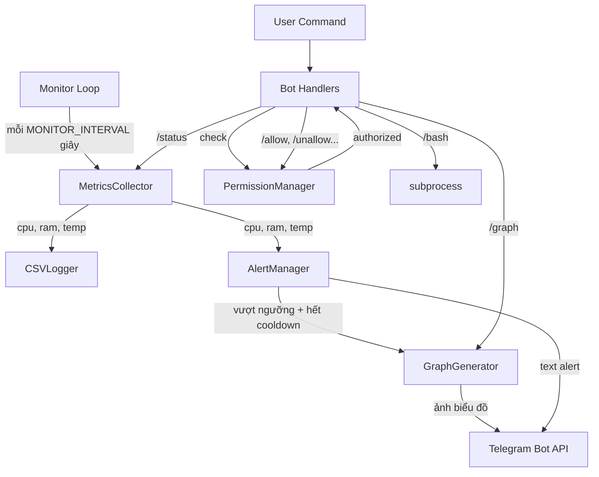

# Design Document: System Monitor + Telegram Bot

## Overview

Service Python chạy hai thành phần song song trong cùng một event loop asyncio:

1. **Monitor loop**: Thu thập metrics → ghi CSV → kiểm tra ngưỡng → gửi alert
2. **Telegram Bot**: Nhận lệnh từ user qua polling, xử lý theo phân quyền 3 cấp

Loại bỏ hoàn toàn gateway — sử dụng `python-telegram-bot` v20+ gọi trực tiếp Telegram API.

### Luồng dữ liệu



## Architecture

### Concurrent Execution Pattern

Sử dụng `python-telegram-bot` v20+ với manual lifecycle control thay vì `run_polling()` (vì `run_polling()` block event loop):

```python
async def main():
    # Khởi tạo bot application
    app = Application.builder().token(BOT_TOKEN).build()
    
    # Manual lifecycle
    await app.initialize()
    await app.start()
    await app.updater.start_polling(drop_pending_updates=True)
    
    # Chạy monitor song song
    monitor_task = asyncio.create_task(monitor_loop())
    
    try:
        await monitor_task  # chạy cho đến khi bị cancel
    finally:
        await app.updater.stop()
        await app.stop()
        await app.shutdown()
```

### Project Structure

```
project/
├── monitor/
│   ├── __init__.py
│   ├── config.py          # Load env vars, constants
│   ├── collector.py        # MetricsCollector
│   ├── storage.py          # CSVLogger
│   ├── alerting.py         # AlertManager
│   └── grapher.py          # GraphGenerator
├── bot/
│   ├── __init__.py
│   ├── handlers.py         # Command + callback handlers
│   ├── permissions.py      # PermissionManager
│   └── graph_sender.py     # Tạo và gửi graph qua bot
├── data/
│   └── users.json
├── logs/
├── main.py
├── .env.example
├── requirements.txt
└── monitor.service
```

## Components and Interfaces

### 1. `monitor/config.py` — Config

Singleton module load tất cả env vars một lần khi import.

```python
@dataclass
class Config:
    BOT_TOKEN: str
    ALERT_CHAT_IDS: list[str]
    BOT_ALLOWED_USERS: list[str]
    BOT_ADMIN_USERS: list[str]
    MONITOR_INTERVAL: int = 60
    LOG_DIR: str = "logs"
    LOG_RETENTION_DAYS: int = 60
    THRESHOLD_MEMORY: float = 80.0
    THRESHOLD_CPU: float = 90.0
    THRESHOLD_TEMP: float = 85.0
    ALERT_COOLDOWN_SECONDS: int = 300
```

### 2. `monitor/collector.py` — MetricsCollector

```python
@dataclass
class SystemMetrics:
    cpu_percent: float
    mem_percent: float
    mem_used_mb: float
    mem_total_mb: float
    cpu_temp_c: float | None  # None nếu platform không hỗ trợ

class MetricsCollector:
    def collect() -> SystemMetrics
```

Platform detection cho nhiệt độ:
- Linux: `psutil.sensors_temperatures()` → key `coretemp` hoặc `cpu_thermal` hoặc first available
- macOS/Windows: thường không hỗ trợ → return `None`
- Wrap trong try/except, không bao giờ crash

### 3. `monitor/storage.py` — CSVLogger

```python
class CSVLogger:
    def __init__(self, log_dir: str)
    def write(self, metrics: SystemMetrics) -> None
    def cleanup_old_files(self, retention_days: int) -> None
    def read_recent(self, hours: int) -> list[dict]
```

Daily rotation strategy: **check-on-write**. Mỗi lần `write()`, so sánh ngày hiện tại với ngày của file đang mở. Nếu khác ngày → đóng file cũ, mở file mới. Đơn giản và đáng tin cậy hơn scheduler.

CSV columns: `timestamp,cpu_percent,mem_percent,mem_used_mb,mem_total_mb,cpu_temp_c`

Khi metric không có (ví dụ temp = None) → ghi empty string.

### 4. `monitor/alerting.py` — AlertManager

```python
class AlertManager:
    def __init__(self, bot: Bot, config: Config)
    async def check_and_alert(self, metrics: SystemMetrics) -> None
    async def send_startup_notification(self) -> None
```

Cooldown tracking per metric:
```python
self._last_alert: dict[str, datetime] = {
    "cpu": datetime.min,
    "memory": datetime.min,
    "temperature": datetime.min,
}
```

Mỗi lần check: so sánh `now - last_alert[metric_type] > ALERT_COOLDOWN_SECONDS`. Nếu vượt ngưỡng VÀ hết cooldown → gửi alert + graph 12h.

### 5. `monitor/grapher.py` — GraphGenerator

```python
class GraphGenerator:
    def generate(self, data: list[dict], hours: int, config: Config) -> Path | None
```

Tạo figure với 3 subplot:
1. CPU % (blue) + threshold line (orange dashed)
2. RAM % (red) + threshold line (orange dashed)  
3. CPU Temp °C (purple) + threshold line (orange dashed)

Nếu tất cả temp data là empty → ẩn subplot 3 (chỉ tạo 2 subplot).

X-axis: `MM-DD HH:MM`, rotated 45°. Lưu vào temp file, caller chịu trách nhiệm xóa sau khi gửi.

### 6. `bot/permissions.py` — PermissionManager

```python
class PermissionManager:
    def __init__(self, config: Config)
    def is_admin(self, user_id: str) -> bool
    def is_authorized(self, user_id: str) -> bool
    def add_allowed_user(self, user_id: str) -> None
    def remove_allowed_user(self, user_id: str) -> None
    def add_alert_recipient(self, user_id: str) -> None
    def remove_alert_recipient(self, user_id: str) -> None
    def get_allowed_users(self) -> list[str]
    def get_alert_recipients(self) -> list[str]
    def _load_persisted(self) -> None
    def _save(self) -> None
```

Startup merge logic:
1. Load `BOT_ADMIN_USERS` từ env → immutable set
2. Load `BOT_ALLOWED_USERS` từ env
3. Load `ALERT_CHAT_IDS` từ env
4. Load `data/users.json` nếu tồn tại
5. Union env lists + json lists (loại bỏ trùng lặp)
6. Admin list chỉ từ env, không persist

`data/users.json` format:
```json
{
  "allowed_users": ["123456789"],
  "alert_chat_ids": ["123456789"]
}
```

### 7. `bot/handlers.py` — Command Handlers

Tất cả handlers đều là async functions nhận `(update, context)`.

Permission check pattern:
```python
async def status_command(update, context):
    user_id = str(update.effective_user.id)
    if not permission_manager.is_authorized(user_id):
        await update.message.reply_text("❌ Bạn chưa được cấp quyền...")
        return
    # ... handle command
```

Handlers:
- Public: `start_command`, `id_command`, `help_command`
- Authorized: `status_command`, `graph_command`, `ping_command`
- Admin: `bash_command`, `allow_command`, `unallow_command`, `addalert_command`, `removealert_command`, `listusers_command`
- Callback: `button_callback` cho inline keyboard

`/bash` implementation: `asyncio.create_subprocess_shell()` với timeout 30s, output truncated tại 4096 chars.

### 8. `bot/graph_sender.py` — Graph Sender

```python
async def send_graph(bot: Bot, chat_id: str, hours: int, csv_logger: CSVLogger, config: Config) -> None
```

Đọc data từ CSVLogger → tạo graph via GraphGenerator → gửi photo qua bot → xóa temp file.

### 9. `main.py` — Entry Point

```python
async def main():
    config = load_config()
    
    # Init components
    csv_logger = CSVLogger(config.LOG_DIR)
    permission_manager = PermissionManager(config)
    
    # Build bot application
    app = Application.builder().token(config.BOT_TOKEN).build()
    register_handlers(app, permission_manager, csv_logger, config)
    
    # Init alert manager (needs bot instance for sending)
    alert_manager = AlertManager(app.bot, config)
    
    # Start bot
    await app.initialize()
    await app.start()
    await app.updater.start_polling(drop_pending_updates=True)
    await app.bot.set_my_commands([...])
    
    # Send startup notification
    await alert_manager.send_startup_notification()
    
    # Run monitor loop
    collector = MetricsCollector()
    try:
        while True:
            try:
                metrics = collector.collect()
                csv_logger.write(metrics)
                await alert_manager.check_and_alert(metrics)
                csv_logger.cleanup_old_files(config.LOG_RETENTION_DAYS)
            except Exception as e:
                logging.error(f"Monitor cycle error: {e}", exc_info=True)
            await asyncio.sleep(config.MONITOR_INTERVAL)
    finally:
        await app.updater.stop()
        await app.stop()
        await app.shutdown()
```

## Data Models

### SystemMetrics

```python
@dataclass
class SystemMetrics:
    timestamp: datetime
    cpu_percent: float        # 0.0 - 100.0
    mem_percent: float        # 0.0 - 100.0
    mem_used_mb: float        # >= 0
    mem_total_mb: float       # > 0
    cpu_temp_c: float | None  # None khi không hỗ trợ
```

### CSV Row Format

| Column | Type | Example | Khi không có |
|---|---|---|---|
| timestamp | string | 2025-01-15 14:30:00 | Bắt buộc |
| cpu_percent | float | 45.2 | Bắt buộc |
| mem_percent | float | 72.1 | Bắt buộc |
| mem_used_mb | float | 5832.5 | Bắt buộc |
| mem_total_mb | float | 8192.0 | Bắt buộc |
| cpu_temp_c | float/empty | 65.0 hoặc "" | Empty string |

### User Permission Data (`data/users.json`)

```json
{
  "allowed_users": ["123456789", "987654321"],
  "alert_chat_ids": ["123456789", "555555555"]
}
```


## Correctness Properties

*A property is a characteristic or behavior that should hold true across all valid executions of a system — essentially, a formal statement about what the system should do. Properties serve as the bridge between human-readable specifications and machine-verifiable correctness guarantees.*

### Property 1: MetricsCollector output validity (Invariant)

*For any* call to `MetricsCollector.collect()`, the returned `SystemMetrics` SHALL have: `cpu_percent` in [0, 100], `mem_percent` in [0, 100], `mem_used_mb >= 0`, `mem_total_mb > 0`, `mem_used_mb <= mem_total_mb`, and `cpu_temp_c` is either `None` or a non-negative float.

**Validates: Requirements 1.1, 1.2, 1.3, 1.4**

### Property 2: CSV write/read round-trip (Round Trip)

*For any* valid `SystemMetrics` object, writing it via `CSVLogger.write()` and then reading it back via `CSVLogger.read_recent()` SHALL produce a record with equivalent values (within floating-point tolerance for numeric fields).

**Validates: Requirements 2.1**

### Property 3: Daily file rotation by date (Invariant)

*For any* two `SystemMetrics` written on different calendar dates, the CSVLogger SHALL write them to different files, and the filename for each SHALL match the pattern `system_stats_YYYYMMDD.csv` corresponding to that date.

**Validates: Requirements 2.2, 2.3**

### Property 4: None metric serialized as empty string (Invariant)

*For any* `SystemMetrics` where `cpu_temp_c` is `None`, the corresponding CSV row SHALL contain an empty string in the `cpu_temp_c` column.

**Validates: Requirements 2.4**

### Property 5: Log cleanup respects retention period (Invariant)

*For any* set of log files with various dates, after calling `cleanup_old_files(retention_days)`, no file with a date older than `retention_days` days ago SHALL remain, and all files within the retention period SHALL be preserved.

**Validates: Requirements 2.5**

### Property 6: Alert threshold detection (Invariant)

*For any* `SystemMetrics` where at least one metric exceeds its configured threshold (and cooldown is not active), `AlertManager.check_and_alert()` SHALL trigger an alert. *For any* `SystemMetrics` where all metrics are below their thresholds, no alert SHALL be triggered.

**Validates: Requirements 3.1**

### Property 7: Independent cooldown per metric (Invariant)

*For any* sequence of metric checks, triggering a cooldown for one metric type (e.g., CPU) SHALL NOT affect the cooldown state of other metric types (e.g., RAM, temperature). Within a cooldown period for a specific metric, additional alerts for that same metric SHALL be suppressed while alerts for other metrics remain unaffected.

**Validates: Requirements 3.2, 3.3**

### Property 8: Config parsing with defaults (Round Trip)

*For any* set of environment variables (including missing ones), the Config module SHALL parse comma-separated lists into Python lists, and use the specified default values for any missing configuration key.

**Validates: Requirements 4.1, 4.2, 4.3**

### Property 9: Permission tier classification (Invariant)

*For any* user ID, the PermissionManager SHALL classify the user into exactly one tier: Admin (if in `BOT_ADMIN_USERS`), Authorized (if in `BOT_ALLOWED_USERS` but not Admin), or Public (otherwise). Admin users SHALL have access to all commands. Authorized users SHALL be denied admin-only commands. Public users SHALL only access `/start`, `/id`, and `/help`.

**Validates: Requirements 5.1, 5.2, 5.3**

### Property 10: User list merge is union without duplicates (Invariant)

*For any* two lists of user IDs (one from `.env`, one from `users.json`), the merged result SHALL be the set union — containing every ID from both sources exactly once, with no duplicates.

**Validates: Requirements 5.5**

### Property 11: User persistence round-trip (Round Trip)

*For any* sequence of add/remove operations on allowed users or alert recipients, the persisted `users.json` SHALL reflect the current state, and reloading from that file SHALL restore the same state.

**Validates: Requirements 5.6, 5.7**

### Property 12: Graph hours validation (Invariant)

*For any* integer hours value, the `/graph` command SHALL accept values in [1, 48] and reject values outside this range with an error message.

**Validates: Requirements 7.2, 7.3**

### Property 13: Bash output truncation (Metamorphic)

*For any* string longer than 4096 characters, the truncation function SHALL return a string of at most 4096 characters. *For any* string of 4096 characters or fewer, the string SHALL be returned unchanged.

**Validates: Requirements 8.2**

### Property 14: Graph subplot count based on temperature data (Invariant)

*For any* dataset, the GraphGenerator SHALL produce 3 subplots when temperature data is present, and 2 subplots when all temperature values are absent.

**Validates: Requirements 9.1, 9.4**

### Property 15: Error resilience — subsystem isolation (Invariant)

*For any* exception raised within a monitor cycle or bot command handler, the service SHALL catch the exception, log it, and continue operation without crashing.

**Validates: Requirements 11.2, 11.3, 11.4**

## Error Handling

### Strategy per subsystem

| Subsystem | Error Behavior |
|---|---|
| MetricsCollector | Catch `psutil` exceptions, return safe defaults (0.0 for CPU/RAM, None for temp). Log warning. |
| CSVLogger | Catch IOError on write, log error with traceback, skip the write. Never crash monitor loop. |
| AlertManager | Catch Telegram API errors on send, log error. Alert failure does not block next cycle. |
| GraphGenerator | Catch matplotlib errors, return None. Caller handles None gracefully. |
| Bot Handlers | Each handler wrapped in try/except. On error: reply error message to user, log traceback. |
| Main Loop | Monitor loop catches all exceptions per cycle. Bot error handler catches unhandled handler errors. |

### Logging

- Sử dụng Python `logging` module
- Format: `%(asctime)s - %(name)s - %(levelname)s - %(message)s`
- Log to stderr (console) — systemd sẽ capture vào journal
- Mỗi exception log với `exc_info=True` để có full stack trace

## Testing Strategy

### Testing Framework

- **Unit tests**: `pytest`
- **Property-based tests**: `hypothesis` (thư viện PBT phổ biến nhất cho Python)
- Mỗi property test chạy tối thiểu 100 iterations

### Unit Tests

Focus vào:
- Specific examples cho các command handlers
- Edge cases: empty input, missing env vars, corrupt CSV files
- Integration points: bot handler → permission check → response

### Property-Based Tests

Mỗi correctness property ở trên sẽ được implement thành một property-based test riêng biệt sử dụng `hypothesis`.

Annotation format cho mỗi test:
```python
# Feature: system-monitor-telegram-bot, Property N: <property_text>
@given(...)
def test_property_name(...):
    ...
```

### Test Organization

```
tests/
├── test_collector.py      # Property 1
├── test_storage.py        # Properties 2, 3, 4, 5
├── test_alerting.py       # Properties 6, 7
├── test_config.py         # Property 8
├── test_permissions.py    # Properties 9, 10, 11
├── test_graph.py          # Properties 12, 14
├── test_handlers.py       # Property 13
└── test_resilience.py     # Property 15
```

### Dependencies

```
python-telegram-bot>=20.0
psutil
python-dotenv
matplotlib
pytest
hypothesis
```
